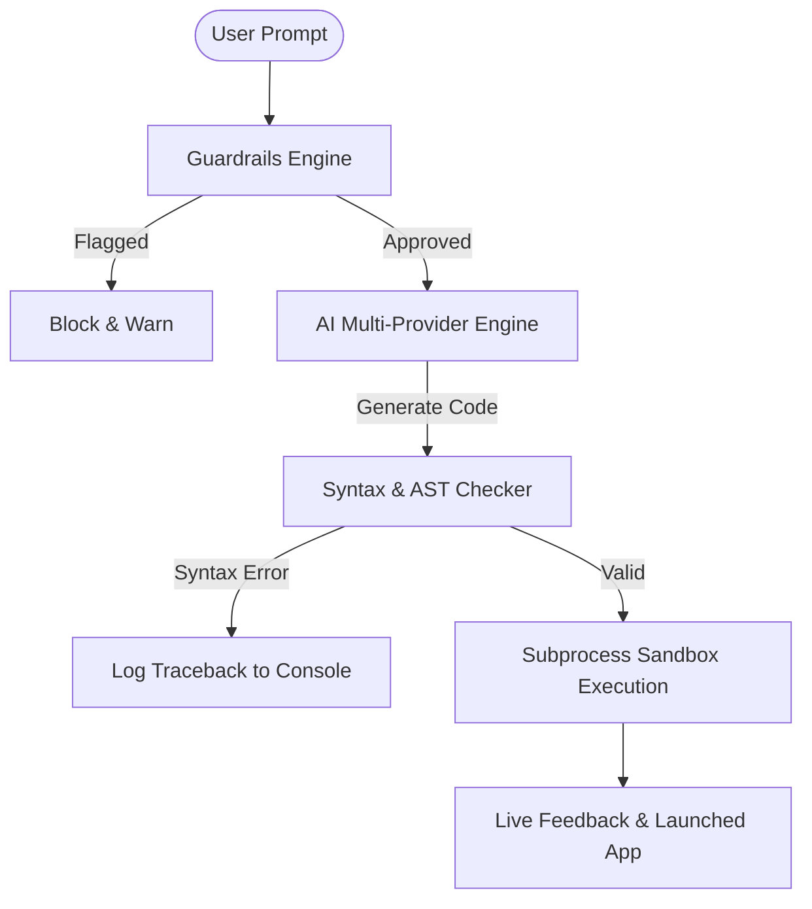

<div align="center">

# ⚡ ZARTOGRIFY ⚡
### Autonomous Local PC Controller & Rapid Software Synthesizer

*Created by ZarTo's Studios*

[](https://python.org)
[](https://github.com/TomSchimansky/CustomTkinter)
[](LICENSE)
[](https://microsoft.com)

<p align="center">
  <b>Zero limits. Real Python power. Local execution sandbox.</b>
  <br />
  Transform natural language instructions into functional desktop software and PC automations instantly.
</p>

---

</div>

## 🌌 Overview

**Zartogrify** is an autonomous AI desktop companion designed to generate, inspect, and execute complete software programs and automation scripts directly inside your local environment.

Unlike traditional chat assistants that provide fragmented snippets, Zartogrify synthesizes end-to-end Python applications (such as editors, calculators, utilities, and diagnostics), validates code syntax in real-time, and launches them within an isolated subprocess runner.

---

## 🚀 Key Highlights

- **⚡ Instant App Generation**: Direct the model in plain language to construct fully interactive graphical applications using `customtkinter` and `tkinter`.
- **🧪 Real-Time Verification**: Automatic syntax parsing and compilation safety sweeps before any code touches the system.
- **🛡️ Built-in Guardrail Shield**: Automated filtering system that flags and halts dangerous disk operations, wipers, and malicious patterns.
- **🔍 PC Ecosystem Scanner**: Detects local environment shortcuts, installed tools, and software paths automatically.
- **🧠 Multi-Provider Architecture**: Dynamic switching between leading inference backends:
  - OpenRouter (Gemini 2.0 Flash, Claude 3.5, LLaMA 3.3, DeepSeek)
  - Groq (Ultra-fast LLaMA & Mixtral inference)
  - OpenAI (GPT-4o, o3-mini)
- **🎨 Catppuccin-Inspired Dark UI**: Polished, eye-friendly desktop interface with modular panels and live execution logs.
- **🔒 Privacy-Focused Local Auth**: Standalone local account management with zero external tracking.

---

## 🛠️ Architecture Workflow



---

## 📦 Project Structure

```text
Zartogrify/
├── modules/
│   ├── ai_engine.py      # Multi-provider LLM connector (OpenRouter / Groq / OpenAI)
│   ├── auth.py           # Local credentials and verification engine
│   ├── executor.py       # Isolated subprocess execution and runtime handler
│   ├── guardrails.py     # Prompt inspection and safety keyword filter
│   └── pc_scanner.py     # Installed applications and shortcut indexer
├── config.example.json   # Template configuration file for model selection and keys
├── requirements.txt      # Python dependencies
├── run.bat               # One-click launch script for Windows
├── main.py               # Main CustomTkinter desktop interface
└── README.md             # Project documentation
```

---

## ⚙️ Quick Start

### 1. Clone & Set Up

```bash
git clone https://github.com/ZarToStudios/Zartogrify.git
cd Zartogrify
```

### 2. Install Dependencies

```bash
pip install -r requirements.txt
```

### 3. Configure API Keys

Copy the sample configuration file and add your preferred provider credentials:

```bash
copy config.example.json config.json
```

Or configure your keys directly inside the application via **Settings & Models**.

### 4. Run Zartogrify

You can launch using the included batch script:

```cmd
run.bat
```

Or directly with Python:

```bash
python main.py
```

---

## 🔒 Security & Sandboxing

Zartogrify runs generated scripts via isolated Python subprocesses with execution timeouts. The built-in `GuardrailsEngine` actively monitors user requests against destructive patterns before queries reach the language models.

---

## 📜 License

Distributed under the MIT License. Developed with pride by **ZarTo's Studios**.
